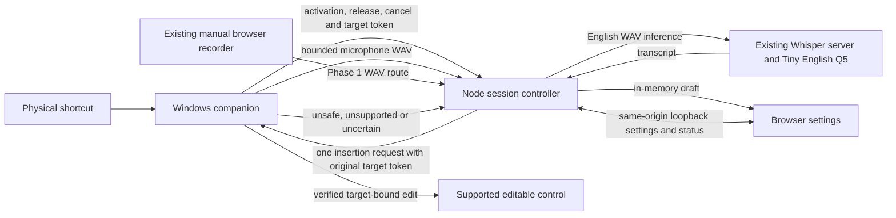
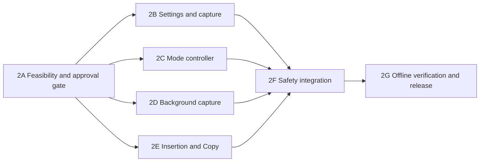

# Press Phase 2 implementation plan

**Status** — Awaiting owner approval. Phase 1 baseline is `588455284db223e08ca46462627a088b238fdc90`. Preserve its tests, evidence, browser recorder, and local English inference stack. Before approved application implementation, announce **🚨 CODING STARTS NOW**.

**Outcome** — With Press running in the Windows user session, use an owner-selected shortcut to record or cancel English speech without opening the browser or moving focus. Insert one result when the original editor can be verified and addressed safely. Keep an in-memory result with a manual Copy action otherwise. Settings and the existing manual recorder can open in the user's browser on demand. A minimal notification-area control may expose Settings, status, and Quit. Overlay and waveform remain Phase 4.

## Roadmap and decision

Phase 2 now includes the safe insertion path originally proposed for Phase 3. Phase 3 becomes coverage and reliability expansion for additional editors or providers after Phase 2 establishes its compatibility matrix. Phases 4–6 retain their overlay, multilingual, and optimization/release objectives. The existing English Tiny Q5 model and pinned OpenWhispr 0.0.11 Windows CPU server remain the only inference assets. No streaming, cloud service, extra model, or repeated engine benchmark is needed.

**Recommended direction** — Retain the Node supervisor and browser for settings and manual dictation. Plan for one minimal Windows companion for global input, background microphone capture, and target-bound editing. Make the companion and its delivery method an explicit feasibility decision before production integration. Prefer small verified precompiled artifacts. If the required native capabilities need Press-specific code, propose a single Win32 x64 helper built from source with Windows APIs and a small reproducible hosted build. Obtain owner approval for a new build toolchain, desktop framework, or major architecture change before adopting it. If a safe target-bound capability is unavailable for an app, the supported path is manual Copy.

### Research and limits

- **Keyboard.** Win32 `RegisterHotKey` provides registration failure for some conflicts and `MOD_NOREPEAT`, but provides an activation message rather than a complete key-release stream. Its standard modifiers are not side-specific and Windows-key shortcuts are reserved. A restricted native listener can track press/release, scan codes and left/right modifiers. Low-level hooks require a responsive message pump, can be silently removed after timing out, and cannot enumerate all app bindings. Prefer narrowly scoped, pass-through observation, with safety filtering and a visible disable setting. Do not use polling a browser for global keys. [RegisterHotKey](https://learn.microsoft.com/en-us/windows/desktop/api/winuser/nf-winuser-registerhotkey) · [Low-level keyboard hook behavior](https://learn.microsoft.com/en-us/windows/win32/winmsg/lowlevelkeyboardproc)
- **OpenWhispr keyboard helper.** At source revision `007826d936af15e89291c1106042f1b280a75933`, the native listener takes a binding at launch and emits `READY`, `KEY_DOWN`, and `KEY_UP`. It uses `WH_KEYBOARD_LL`, passes events onward, and recognizes `RightCtrl`, `CapsLock`, and modifier-only chords. Generic chord modifiers are coarse. Its single-binding protocol lacks interactive capture and simultaneous active-session Escape. It is a useful 2A baseline, subject to matching the exact release to source and verifying behavior. Avoid transplanting Electron's manager wholesale. [Listener source](https://github.com/OpenWhispr/openwhispr/blob/007826d936af15e89291c1106042f1b280a75933/resources/windows-key-listener.c) · [Node manager reference](https://github.com/OpenWhispr/openwhispr/blob/007826d936af15e89291c1106042f1b280a75933/src/helpers/windowsKeyManager.js)
- **Standalone releases found.** `windows-key-listener-v1.0.0` has `windows-key-listener-win32-x64.zip` (81,131 bytes, SHA-256 `fee00d48ac03c72c9183b13245a57518ccc6bc94c12d1c0e11ec306b5911c896`). `windows-fast-paste-v2.0.0` has `windows-fast-paste-win32-x64.zip` (80,466 bytes, SHA-256 `80414b7d0cf8b0b85cbbba998e0fcad7c6146f006a0296592743055bcb792ce5`). These are published archive metadata, with no local download or execution during planning. At 2A confirm asset provenance, signature status, release commit, hash, notices, and protocol before running the relevant helper. MIT reuse requires retaining the applicable OpenWhispr copyright and license text. [Keyboard release](https://github.com/OpenWhispr/openwhispr/releases/tag/windows-key-listener-v1.0.0) · [Paste release](https://github.com/OpenWhispr/openwhispr/releases/tag/windows-fast-paste-v2.0.0) · [OpenWhispr license](https://github.com/OpenWhispr/openwhispr/blob/007826d936af15e89291c1106042f1b280a75933/LICENSE)
- **Microphone.** An open browser page may capture when hidden or minimized, but permission, activation and the lifecycle of the document still matter. A frozen page stops running ordinary tasks, and a discarded or closed page cannot start capture. A WebSocket alone does not provide an always-ready recording context. Keep the proven Web Audio capture for manual fallback. For reliable browser-closed background capture use Windows shared-mode WASAPI and produce the same mono 16 kHz PCM16 WAV contract. Neither OpenWhispr helper implements microphone capture. [Chrome page lifecycle](https://developer.chrome.com/docs/web-platform/page-lifecycle-api) · [WASAPI](https://learn.microsoft.com/en-us/windows/win32/coreaudio/wasapi)
- **Insertion.** OpenWhispr's fast-paste helper detects a target window, can try to restore it, and dispatches paste via foreground input. Its source explicitly falls through to the current foreground window if restoration fails. It also supports terminal paste. Do not use its unmodified paste path for automatic insertion. Reuse only useful target-identification ideas or audited snippets with notices. `SendInput` targets the input stream, so a focus check immediately before sending does not fully remove the focus race. UI Automation can identify a specific editable element, but identifying it does not imply safe caret-level writing. Use target-bound editing verified per control/provider and fail closed. [Paste helper source](https://github.com/OpenWhispr/openwhispr/blob/007826d936af15e89291c1106042f1b280a75933/resources/windows-fast-paste.c) · [SendInput and UIPI](https://learn.microsoft.com/en-us/windows/win32/api/winuser/nf-winuser-sendinput) · [UI Automation focused elements](https://learn.microsoft.com/en-us/windows/win32/winauto/uiauto-obtainingelements)

### Shortcut compatibility policy

| Example | Initial treatment |
| --- | --- |
| Right Ctrl | Feasibility candidate as a side-specific modifier. A hold binding can also participate in ordinary Ctrl chords. Test cancel-on-other-key before insertion and warn about the overlap. Accept only if normal Ctrl actions still behave. |
| Ctrl + Shift + Windows | Representable in native observation but OS-reserved under the normal registration policy. Reject Windows-key bindings initially, including modifier-only chords with Windows. |
| Ctrl + Caps Lock | Feasibility candidate. Test keyboard layout, IME/accessibility conflicts, and Caps Lock state. A pass-through binding can affect lock state, so decline it if normal keyboard behavior cannot be preserved for the tested setup. |
| Alt + Space | Reject as a Windows window-menu binding. |
| Other chords | Prefer unused function keys or modifier-plus-key combinations. Reject normal typing keys alone, bare Escape for dictation, known OS and accessibility bindings, unsupported sequences, and observable conflicts. Offer side qualifiers only where the adapter demonstrably supports them. |

Conflict detection cannot inventory every third-party or app shortcut. Distinguish definite OS or registration conflicts from possible application conflicts. Show a test preview without recording and provide a clear way to disable the shortcut. An observing hook must not cancel OS or app shortcuts to make Press work. For a verified reservable chord, document that registration takes ownership of just that chord. Escape starts as the fixed, displayed cancellation shortcut for Phase 2 and is acted on only during a session. Let the foreground application receive Escape as well unless a later approved design establishes safe suppression.

## Architecture and contracts

- Spawn the helper as an owned standard-user child. Use private inherited pipes, versioned messages, size limits, request IDs, startup deadlines and explicit cancel/exit. Control messages carry `sessionId`; a bounded length-prefixed binary frame carries WAV. The helper retains the OS target handle/element, gives Node only an opaque token, and invalidates it on focus loss, destruction or session cancel. Do not log keys, titles, field contents, speech, or handle data. Report only event names and error codes.
- Logical events are `ready`, `shortcutDown`, `shortcutUp`, `escape`, `targetInvalidated`, `captureResult` and `insertResult`. Commands include `applyBinding`, `beginShortcutCapture`, `endShortcutCapture`, `beginCapture`, `stopCapture`, `cancelCapture`, `insert`, and `quit`. Capture the intended target at activation, before recording or settings can change focus. Keep capture preview separate and scoped to the settings dialog.
- One session owns capture and inference across both entry points. States are Idle, Starting, Recording, Stopping, Transcribing, Inserting, and Result or Error. IDs reject stale events and results. Disable or Escape invalidates the result before insertion; cancellation after an edit is dispatched cannot retract it. Existing Whisper has no assumed per-request cancellation. Quarantine completion and serialize the next inference until the active one settles or the owned child is stopped safely.
- Reuse `createWhisperSession()`, the browser recorder, and the WAV contract. Share WAV validation and job ownership between the browser route and native path. Browser POST keeps same-origin/Host validation. Settings/status routes remain loopback, with Host checks, same-origin mutation checks, strict schemas, and no arbitrary paths, commands, window targets, or key events from the page. Manual result stays in memory and becomes available via an explicit Settings/Copy action. Have the browser obtain a bounded lease before opening the mic and release it on cancel, disconnect, or completion. Check the lease at upload. Node arbitrates it alongside native recording.
- Settings are versioned JSON in current-user local app data, with atomic writes and safe defaults: disabled on first run, no assigned key, selectable displayed mode, optional validated microphone ID and Escape displayed. Repair malformed settings with an explanation. Keep the browser closed during ordinary hotkey operation after initially launching Press, and surface status in the Windows notification area or equivalent lightweight access point.

Once 2A freezes contracts, the settings UI, pure mode logic, audio adapter and insertion adapter can be tested independently with fakes. Integrate shared supervisor/helper changes sequentially where they touch the same files. Filenames below are proposed ownership boundaries. Final native filenames depend on the approved 2A choice.

## 2A — Windows keyboard and companion feasibility

**Build and why.** Establish which low-footprint native design can report exact key transitions, observe Escape during a session, and coexist with Windows and ordinary application shortcuts. Confirm delivery and inspect candidate capture/insertion capabilities before promising broad app support.

- **Technology/files.** Existing Node and Win32 APIs. Use the pinned OpenWhispr keyboard ZIP only if it meets provenance checks, staged under ignored `runtime/` after approval. Read only the relevant fast-paste source and release metadata for insertion risks. Record findings in `docs/phase-2-feasibility.md`; if useful, add `tests/windows-shortcut-probe.mjs` for transient checks and `docs/THIRD-PARTY-NOTICES.md` for reused code/assets.
- **Steps and communication.** Compare registration vs restricted observation, then parse the helper's streaming lines with a bounded Node adapter. Test single modifier, multi-key release order, repeated keys, key sides, layout/AltGr, rebind, Escape, synthetic events, sleep/lock and helper shutdown. Check whether an owned single companion can provide WASAPI and target-bound insertion, and what it costs in artifact size, build requirements and runtime memory. Inspect browser/minimized/closed behavior as a fallback comparison. Record which development dependency would be needed and ask for approval if the chosen route requires a new native build path.
- **Acceptance.** Provide measured press/release and shutdown behavior, support/reject decisions for all sample chords, a documented asset/protocol choice, and an initial per-app target matrix. Automated tests parse split/repeated events and simulated failure. Manual tests verify normal Ctrl, Caps Lock and reserved combos still work, with no background key history. 2A must surface capability gaps before 2B–2F implementation relies on them.

## 2B — Shortcut capture and local settings

**Build and why.** Let the user choose a key and mode without editing files or restarting Press. Provide enable/disable, displayed Escape, status, shortcut preview, and optional microphone selection if enumeration is viable.

- **Technology/files.** Add `settings.mjs`, `shortcuts.mjs`, `public/settings.html`, `public/settings.mjs`, and `tests/settings.test.mjs`. Update the static allowlist in `server.mjs`. Adapt the upstream binding format only at the native adapter boundary when reusable. Use the built-in filesystem, browser controls and the 2A adapter.
- **Steps and communication.** Enter scoped capture while the settings control is focused, suspend activation and collect only the proposed binding. Normalize physical identity, modifier alternatives/sides, display label and length. Use native validation where the browser cannot identify a key reliably. Cancel with Escape, timeout or focus loss. Validate candidate, disable the old binding, attach the new one when all chord keys are up, confirm readiness, persist only on success, and restore the old binding on failure. Defer mode/rebind changes during active capture until Idle, with visible pending status. Disable cancels immediately.
- **Acceptance.** Node tests cover malformed settings, round-trip, reserved keys, normalization, hot rebind rollback and restart persistence. Manually capture and change a proven single key and chord, toggle modes and enabled state, and confirm no recapture-triggered dictation. If device selection is deferred, show Windows default microphone clearly.

## 2C — Hold-to-talk and tap-to-toggle

**Build and why.** Translate raw shortcut transitions into exactly one recording session with the user-selected stop behavior.

- **Technology/files.** Add `dictation-session.mjs` and `tests/dictation-session.test.mjs` using Node and deterministic fake adapters. Use only key-edge concepts from OpenWhispr.
- **Steps and communication.** Snapshot mode and target at accepted key-down. Hold stops when a required member releases. Toggle starts on the first clean press and stops on a second press after complete release. Suppress repeats and overlaps, ignore unrelated releases, and handle release or stop during microphone startup without reopening a late stream. Treat stray conflicting input on a modifier-only binding conservatively. Hold a lease through result handling and serialize transcription.
- **Acceptance.** Test both paths, repeated down/up, key-release order, held-key rearm, immediate release, two presses during startup, late results, mode reconfiguration, and overlap with the manual route. Manually verify both modes in another app without changing its focus.

## 2D — Background microphone recording

**Build and why.** Record while another app is focused and while the settings browser is closed. Pass equivalent WAV data to the existing engine.

- **Technology/files.** Provisional `native/windows/capture.cpp`, `windows-companion.mjs`, `wav-validation.mjs`, and `tests/background-capture.test.mjs`. Update `server.mjs` and the manual recorder integration for shared ownership. Prefer WASAPI with the current user's default capture endpoint, existing browser WAV tools for manual mode, and no reuse of Electron recording infrastructure.
- **Steps and communication.** Open the capture endpoint only on Start. Acquire shared-mode packets, normalize channels/rate with a verified Windows conversion route or bounded converter, and serialize canonical PCM16 WAV, capped at the existing 60 seconds. Send capture data over the private pipe, release audio resources on every exit, and use the same WAV validation and English inference as Phase 1. Handle Windows privacy permissions, removed devices, no speech, partial capture and endpoint change. Preserve native and browser input availability as separate user-facing statuses.
- **Acceptance.** Test frame counts, format, cap, missing packets, malformed/bounded data, cleanup after cancel and late start, and resource ownership across manual/native sessions. Manually record with the browser minimized and closed, with another app focused, and after device removal or privacy denial. Verify clean retry and mic release. Exercise alternate sample rates observed on the machine.

## 2E — Automatic insertion and clipboard handling

**Build and why.** Deliver one transcript to the original verified editable control without Enter, submission, execution, or accidental cross-window insertion.

- **Technology/files.** Provisional `native/windows/target.cpp`, `insertion.mjs`, `tests/insertion.test.mjs`, and per-app results in `docs/phase-2-compatibility.md`. Use Win32 window identity/focus and UI Automation properties for eligibility. Use an allowlisted target-bound edit operation for each validated control. For suitable classic Edit controls, investigate direct selection replacement by child HWND. Investigate verified provider-addressed editing for other controls. Never blindly replace an entire field value to emulate a caret insertion. OpenWhispr detection is a reference and its stock paste dispatch is excluded.
- **Steps and communication.** Capture desktop, window/process instance and focused element at activation. Recheck foreground, focused identity, editability, sensitivity, caret/selection semantics where available, and integrity immediately before dispatch. Invalidate on a focus transition, even if focus later returns. Only perform one operation on the identity-bound target. Treat a timeout or ambiguous result as unknown delivery, offer Copy, and never retry automatically. Skip terminal, elevated, password/protected, unknown, and readonly targets. Reject content containing control sequences that the adapter cannot represent as inert text.
- **Clipboard.** Prefer target-bound direct editing, which leaves the clipboard alone. If a tested target-bound paste adapter needs the clipboard, preserve existing formats where possible and restore only when the clipboard sequence still belongs to Press and safe consumption is established. Skip automatic clipboard-based delivery if lossless handling cannot be demonstrated. Manual Copy is explicit and reports its result.
- **Acceptance.** Verify surrounding text and selections are preserved as specified, only one edit occurs, and neither Submit nor a terminal command executes. Test changed focus within one window/tab, PID/window reuse, protected and readonly controls, IPC failures and clipboard changes. Test Windows Notepad versions, Chrome and Edge plain fields and contenteditables, ChatGPT, WhatsApp Web, Codex, Zed and one ordinary editor. Mark each tested build/control as automatic or Copy only with the reason. Browser page, navigation and editor identity matter independently of the window. Require automatic insertion in at least one real safe editor to accept Phase 2. If intended everyday editors cannot be supported within the approved safety and footprint limits, review the scope with the owner before declaring success.

## 2F — Cancellation, focus safety and error recovery

**Build and why.** Close races across input, microphone, inference and insertion, including hidden-window and shutdown cases.

- **Technology/files.** Extend `dictation-session.mjs`, `windows-companion.mjs`, the native companion dispatcher, and `public/settings.mjs`. Add `tests/dictation-safety.test.mjs`. Reuse audited helper cleanup ideas only.
- **Steps and communication.** Treat Escape during Starting, Recording, Stopping or Transcribing as cancellation. Clear owned audio and block insertion even if a late transcript arrives. Invalidate the target on confirmed or uncertain focus changes. If inference succeeds with an invalid target, make the transcript available only in the Copy fallback. Cancel or disarm safely on helper exit, lock/user switch, suspend and shutdown. Discard injected key events where supported, and ignore insertion-related events as activation. Normalize errors for permission denial, device loss, conflict, lost key-up, server timeout and failed delivery. Store no private keyboard/audio/text data in diagnostics.
- **Acceptance.** Automated tests cover Escape at each stage, stale IDs, focus generation changes, child death, two rapid starts, clipboard contention and simultaneous completion/cancellation. On Windows verify no extra insertions in fast app-switch stress tests, Escape behavior in another app, rebind while busy, sleep/resume and safe Quit. Document unsupported secure desktops and integrity restrictions.

## 2G — Windows integration and offline verification

**Build and why.** Deliver a reproducible startup and settings experience and prove actual offline use on the owner's laptop.

- **Technology/files.** Update `start.cmd` or introduce a lightweight Windows background launch entry point, plus `README.md`, `docs/PROGRESS.md`, `docs/phase-2-compatibility.md`, and new `docs/phase-2-verification.md`. Keep a clear manual browser launch option. Document pinned helper installation and hash verification, and attribute copied source or distributed components.
- **Steps and communication.** Run the preserved Phase 1 suite and the added tests. Verify the helper, browser fallback and same Whisper server from a fresh launch. Coordinate an owner-approved network disconnect. With Settings closed, exercise both modes and automatic insertion in a verified editor, escape/cancel, switch target during transcription and recover via Copy, check a protected target without sending text, test offline restart/persistence, and Quit cleanly. Open other named apps to test compatibility where available, including app/browser builds and field types. Online-only surfaces can be checked separately from the offline system proof.
- **Acceptance.** Record user-observed network state, verified editor/version, shortcut/mode, actual insertion or fallback, clipboard behavior, and cleanup. The automation suite passes, no target misdelivery or silent OS shortcut override is observed, configuration survives restart, and browser Record/Stop/Copy remains usable. Review known limits before acceptance. No new recognition benchmark is required.

## Progress and publication

Track each task in `docs/PROGRESS.md` with status, dependencies, tests, manual evidence, review, branch and hash. Suggested branches: `spike/windows-shortcuts`, `feat/shortcut-settings`, `feat/dictation-modes`, `feat/background-capture`, `feat/targeted-insertion`, `fix/dictation-safety`, and `test/windows-dictation-offline`. After approved implementation per task, run relevant tests, review staged changes, verify ignores, commit, publish the branch with existing secure Git credentials, merge tested work subject to protection, push main, and verify the remote revision. Keep binaries, models, credentials, private recordings, and temporary outputs out of Git. Report decisions, failures and fixes, evidence, branch/commit and remaining work. No forced history updates. No required subagent or model assignment.
